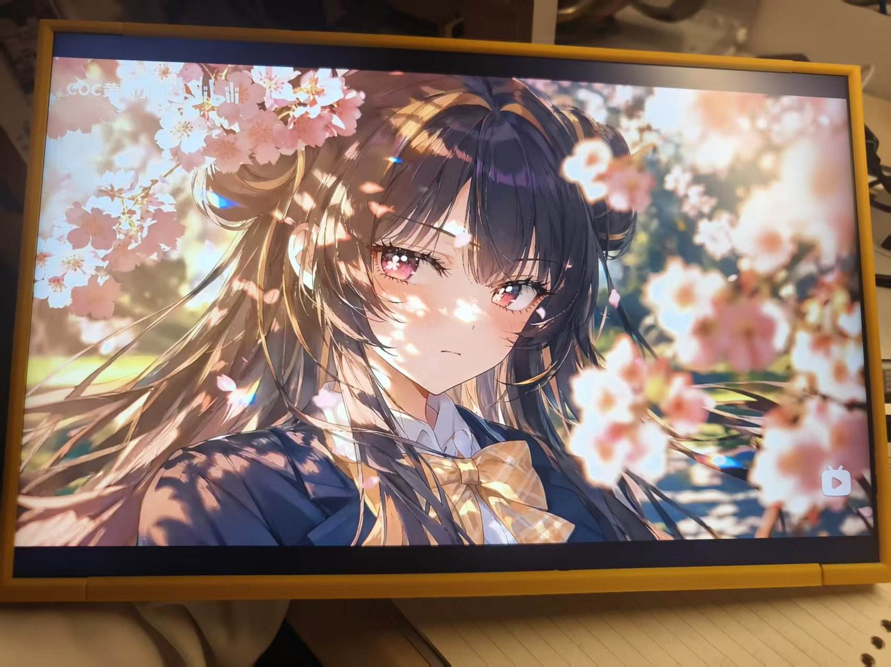
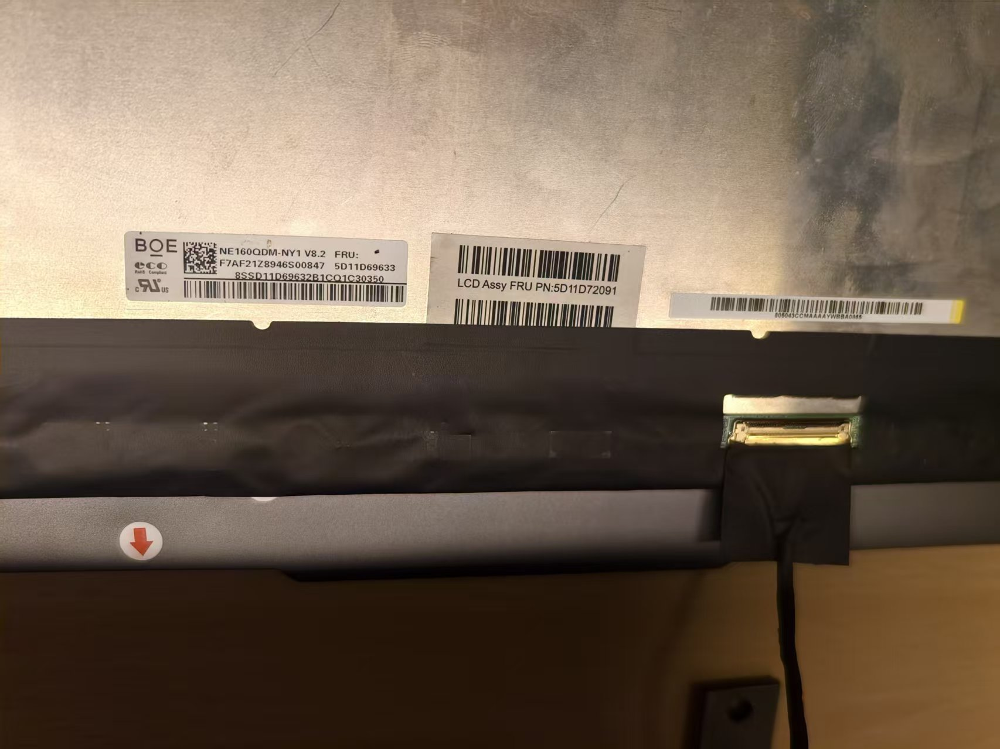
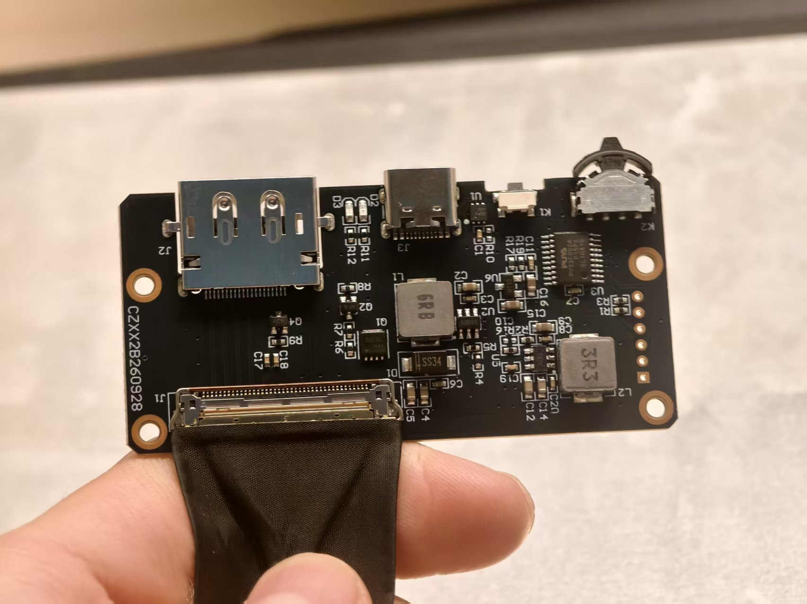
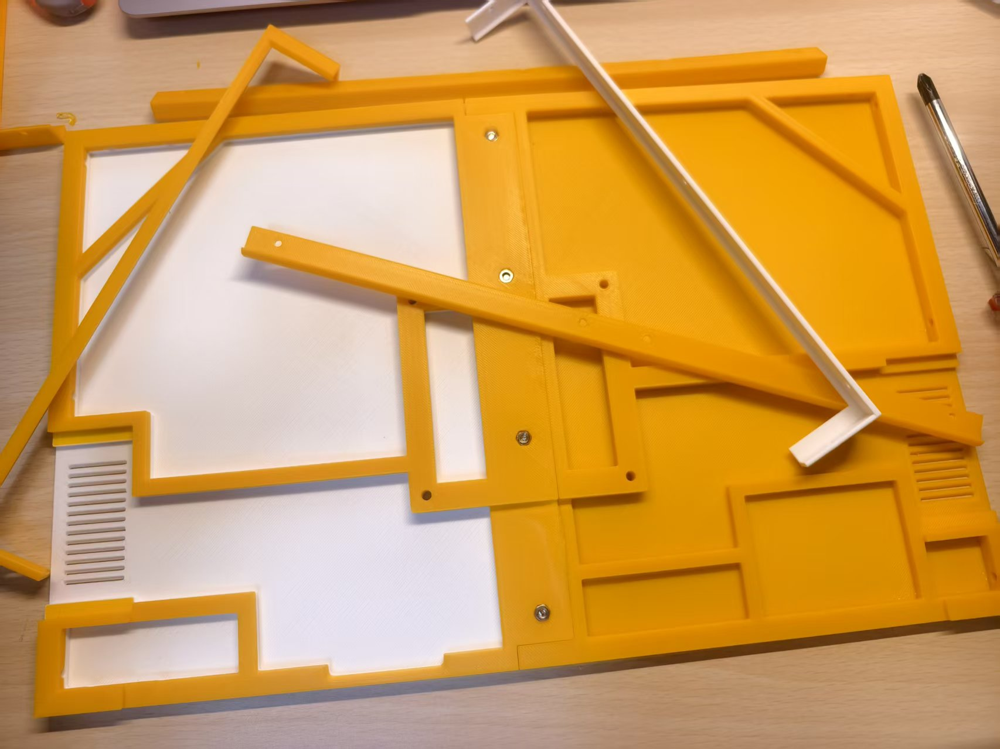

## 前言

　　一块 16 寸 2560×1600、165Hz 的联想笔记本拆机屏，配一块 55 元的通用驱动板，外壳用 3D 打印件，整套成本 164 元。成品有金属质感边框和折叠支架，接上信号源就能当副屏使用。下面记录完整的选料与组装过程。

## 一、准备材料

　　核心部件只有三类，另需少量辅材和工具。成本和难点都在屏幕选型上。

- **屏幕**：联想笔记本拆机屏，型号 BOE NE160QDM-NY1，16 寸、2560×1600、165Hz、40pin eDP 接口，109 元。拆机屏来源复杂，下单前要求卖家拍出背面标签和接口位置。
- **驱动板**：通用 eDP 驱动板，带 DP 输入、屏线接口、按键和独立供电座，55 元。购买时确认支持 2560×1600 输出，并配有对应 40pin 屏线。
- **外壳**：3D 打印件，前框、后壳、支架和螺丝柱分件打印，自己打印所以按 0 元计。没有打印机时需把耗材和打印服务费用算进去。
- **辅材**：驱动板随附的屏线、DP 线、符合驱动板标注规格的电源适配器。
- **工具**：一把十字螺丝刀即可，不需要烙铁。

## 二、确认屏幕型号与接口

　　屏幕背面贴有型号标签，这是核对屏幕规格的唯一可靠依据。

- 标签上的型号为 NE160QDM-NY1，版本 V8.2，FRU 号 5D11D72091。该屏原生 2560×1600、165Hz，40pin eDP，和联想拯救者系列的部分机型通用。
- 屏线接口位于屏幕背面右下角，购买驱动板时要确认屏线针数和接口方向一致。
- 收到屏幕后先通电试亮，检查坏点、亮线和漏光。拆机屏品相差异大，发现问题应当场换货。

## 三、连接驱动板

　　接线顺序固定，先接屏线再接电源，最后接信号源。

- **接屏线**：把屏线金手指对准驱动板插座，轻轻推到底并扣好卡扣；另一端按同样方式接入屏幕背面接口。金手指方向装反会导致无显示，插之前先对比两侧缺口。
- **接信号源**：DP 线一端接电脑或游戏机，一端接驱动板的 DP 输入口。
- **接电源**：按驱动板标注的电压和接口规格接入电源适配器。供电不足时会出现闪屏或反复黑屏。
- **验证点亮**：接通电源后屏幕应显示驱动板的开机画面或菜单；进入系统的显示设置，把分辨率设为 2560×1600，刷新率选 165Hz。如果刷新率选项只有 60Hz，优先换一根规格更高的 DP 线，再检查驱动板是否支持该刷新率。

## 四、打印外壳并组装

　　外壳按屏幕和驱动板的实际尺寸建模，分件打印便于维护和更换。

- 前框留出屏幕可视区和按键孔，后壳预留驱动板与散热空间，支架用螺丝固定并可调角度。
- 打印件装前先除去毛刺，螺丝柱孔位对不上时用钻头轻微扩孔，不要硬拧。
- 屏幕放进前框后装后壳，再固定驱动板和支架。拧螺丝时避开屏幕边缘，液晶面板受力会损坏。
- 装好后再次通电，确认按键、画面和支架角度都正常。

## 五、成本清单

　　价格按实际购买记录列出，不同渠道会有浮动。

| 部件 | 规格 | 价格 |
| --- | --- | --- |
| 屏幕 | 联想拆机屏 BOE NE160QDM-NY1，16 寸 2560×1600 165Hz，40pin eDP | 109 元 |
| 驱动板 | DP 输入、eDP 屏线接口、独立供电 | 55 元 |
| 外壳 | 3D 打印件，自行打印 | 0 元 |
| 合计 |  | 164 元 |

## 六、限制与注意

　　这套方案省钱的代价，是缺少成品便携屏的几项配套能力。

- **没有内置电池**：屏幕和驱动板需要持续外接供电，移动使用时要准备电源或户外电源。
- **音量和菜单靠按键**：驱动板通常没有遥控，亮度、对比度和输入源切换需要通过板载按键完成。
- **刷新率取决于链路**：屏幕支持 165Hz，但实际能否跑满还受驱动板、DP 线材和信号源输出能力限制。
- **拆机屏有品相风险**：亮点、暗斑和轻微漏光较常见，验货环节不能省。
- **外壳成本因人而异**：0 元的前提是已经有 3D 打印机和耗材，没有设备时需另算打印费用。
